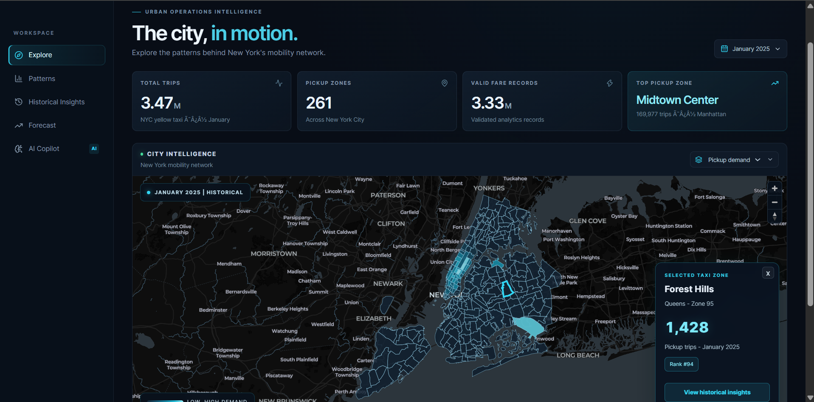
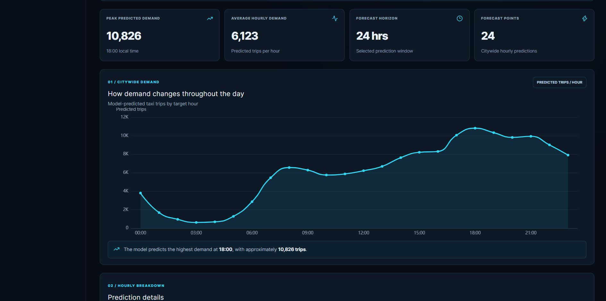
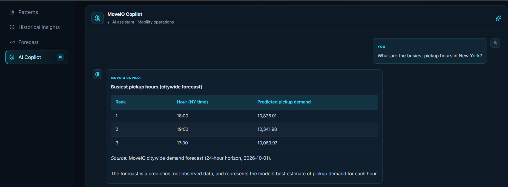

# MoveIQ
### AI-Powered Mobility & Operations Intelligence Platform

MoveIQ is an end-to-end mobility intelligence platform built around NYC Yellow Taxi trip data. It transforms raw transportation records into interactive analytics, historical demand insights, machine-learning forecasts, and AI-powered natural-language exploration.

The platform combines **data engineering, analytical querying, machine learning, geospatial visualization, and generative AI** in a single application.

## Overview

MoveIQ helps users explore urban mobility patterns, compare demand across locations and time periods, forecast future taxi demand, and investigate operational questions through an AI analytics copilot.

## Key Features

- **Mobility Analytics:** Explore trip volume, fares, distances, trip duration, revenue, and demand patterns.
- **Historical Intelligence:** Analyze hourly demand by taxi zone and compare historical periods.
- **Demand Forecasting:** Generate citywide and taxi-zone-level hourly demand forecasts using trained machine-learning models.
- **Geospatial Visualization:** Explore pickup demand across NYC taxi zones through an interactive map.
- **AI Analytics Copilot:** Ask questions in natural language and interact with analytical tools through conversational sessions.
- **Backend API:** Access analytics, forecasting, historical insights, and AI copilot functionality through FastAPI endpoints.
- **Session Management:** Use Redis-backed infrastructure for conversational session management.

## Screenshots

### Main Dashboard


### Demand Forecasting


### AI Analytics Copilot



## Application Architecture

```text
                 NYC TLC Trip Data
                         |
                         v
              Data Processing & Validation
                         |
                         v
                 DuckDB Analytics
                         |
             +-----------+-----------+
             |                       |
             v                       v
      Historical Analytics     ML Forecasting
             |                       |
             +-----------+-----------+
                         |
                         v
                     FastAPI
                         |
                 +-------+-------+
                 |               |
                 v               v
           React Frontend    AI Copilot
                                 |
                              LangGraph
                                 |
                              Groq API
                                 |
                               Redis
```

## Technology Stack

| Area | Technologies |
|---|---|
| Programming | Python 3.12 |
| Data Processing | Pandas, NumPy, PyArrow |
| Analytics & Querying | DuckDB, SQL |
| Data Storage | Parquet |
| Machine Learning | Scikit-learn, XGBoost |
| Backend | FastAPI, Uvicorn |
| Generative AI | LangGraph, Groq API |
| Frontend | React, TypeScript, Vite |
| Geospatial Visualization | MapLibre GL |
| Session Infrastructure | Redis |
| Containerization | Docker, Docker Compose |
| Testing & Quality | Pytest, ESLint |

## Data Sources

**Primary dataset**

- NYC Taxi & Limousine Commission (TLC) Yellow Taxi trip records.
- January 2025 trip data powers the primary mobility analytics implementation.

**Additional dataset**

- UCI Bike Sharing Dataset, used as a secondary data source for mobility-related experimentation.

## Project Structure

```text
MoveIQ/
├── frontend/              # React and TypeScript application
│   ├── src/
│   │   ├── components/    # Reusable UI components
│   │   └── pages/         # Analytics, forecasts and copilot
│   └── public/            # Static assets and geographic data
│
├── src/
│   ├── ai/                # AI copilot, tools and guardrails
│   ├── analytics/         # Analytical query engines
│   ├── api/               # FastAPI application
│   ├── data/              # Data preparation and validation
│   └── ml/                # Feature engineering and forecasting
│
├── data/
│   └── reference/         # Taxi zone reference data
│
├── docs/                  # Architecture and progress notes
├── tests/                 # Automated tests
├── Dockerfile
├── docker-compose.yml
├── requirements.txt
├── requirements-runtime.txt
└── README.md
```

## Running Locally

### 1. Clone the repository

```bash
git clone https://github.com/Varunteja119/MoveIQ.git
cd MoveIQ
```

### 2. Set up the Python environment

```powershell
py -3.12 -m venv .venv
.\.venv\Scripts\Activate.ps1
pip install -r requirements.txt
```

### 3. Configure environment variables

Create a `.env` file in the project root and configure the required API credentials and service settings.

Do not commit API keys or other secrets.

### 4. Start the backend

```powershell
uvicorn src.api.main:app --reload
```

### 5. Start the frontend

Open another terminal:

```powershell
cd frontend
pnpm install
pnpm dev
```

The frontend and backend can now be accessed through their respective local development URLs.

## Running with Docker

MoveIQ includes Docker and Docker Compose configuration for running the API and Redis services.

**Important data prerequisites:** Large datasets, generated feature files, and trained forecasting models are intentionally excluded from Git. The Docker image expects these files at the paths specified in the Dockerfile.

Before building the image:

1. Download and prepare the required NYC TLC historical data.
2. Generate the analytics and machine-learning feature datasets.
3. Train and save the required forecasting models.
4. Ensure all generated artifacts exist at the paths referenced in the Dockerfile.
5. Configure the required environment variables in `.env`.

Then run:

```powershell
docker compose up --build
```

A fresh clone cannot build the Docker image until these data and model artifacts have been generated.

## Testing

The project includes automated tests covering core functionality, including:

- Analytics and comparison logic.
- Forecasting services and feature consistency.
- API endpoints.
- AI context management and related functionality.

Run the Python test suite with:

```powershell
python -m pytest
```

Run frontend linting with:

```powershell
cd frontend
pnpm lint
```

## Future Improvements

- Expand mobility analytics to additional transportation datasets.
- Improve forecasting coverage across more historical periods.
- Add further operational metrics and demand-monitoring capabilities.
- Improve deployment automation and reproducibility.
- Extend AI copilot capabilities with additional analytical workflows.

## Author

**Varun Teja Maddirala**

GitHub: [@Varunteja119](https://github.com/Varunteja119)

## License

No open-source license has been selected yet. All rights are reserved unless otherwise specified.
